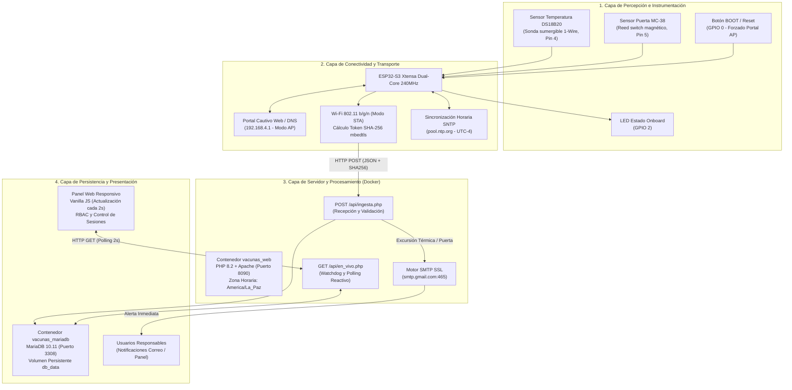
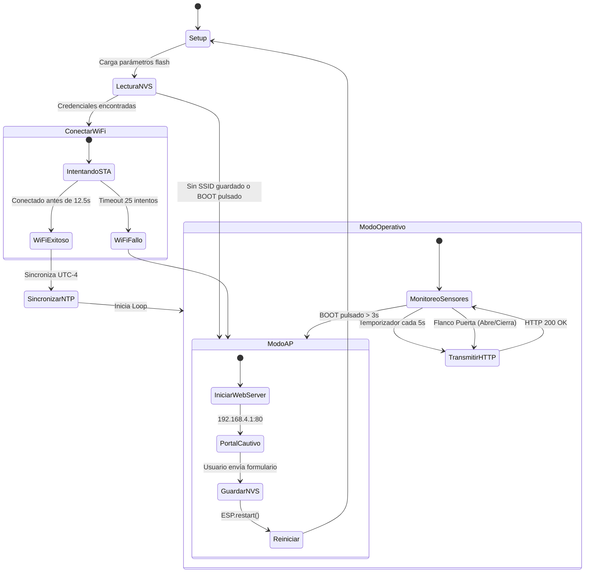
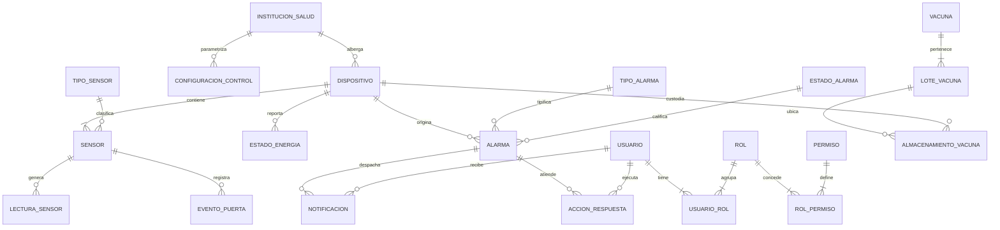

# Documentación Integral del Sistema: Punata Vacuna Segura (PVS) ❄️

> **Documento Maestro de Ingeniería y Operación**  
> **Proyecto:** Sistema Telemétrico IoT en Tiempo Real para el Monitoreo y Control de la Cadena de Frío de Biológicos  
> **Ámbito de Aplicación:** Red de Salud Punata – Centro de Salud La Capilla / Hospital Manuel Ascencio Villarroel (Cochabamba, Bolivia)  
> **Tecnologías Centrales:** ESP32-S3, DS18B20 (1-Wire), MC-38 (Reed Switch), Docker, PHP 8.2, MariaDB 10.11, Gmail SMTP SSL, JavaScript Reactivo.

---

## Índice General

1. [Resumen Ejecutivo y Contexto Sanitario](#1-resumen-ejecutivo-y-contexto-sanitario)
2. [Arquitectura Global del Sistema (4 Capas)](#2-arquitectura-global-del-sistema-4-capas)
3. [Especificación Técnica de Hardware e Instrumentación](#3-especificacion-tecnica-de-hardware-e-instrumentacion)
4. [Diseño y Lógica del Firmware ESP32-S3 (C++)](#4-diseño-y-logica-del-firmware-esp32-s3-c)
5. [Contenedorización con Docker y Configuración de Red](#5-contenedorizacion-con-docker-y-configuracion-de-red)
6. [Modelo de Base de Datos Relacional y Diccionario de Datos](#6-modelo-de-base-de-datos-relacional-y-diccionario-de-datos)
7. [Especificación Exhaustiva de las Interfaces de Datos (APIs)](#7-especificacion-exhaustiva-de-las-interfaces-de-datos-apis)
8. [Motor de Notificaciones y Alertas por Correo (Gmail SMTP)](#8-motor-de-notificaciones-y-alertas-por-correo-gmail-smtp)
9. [Seguridad Informática, Sesiones y Recuperación de Accesos](#9-seguridad-informática-sesiones-y-recuperación-de-accesos)
10. [Manual de Usuario y Operación de Módulos Web](#10-manual-de-usuario-y-operación-de-módulos-web)
11. [Guía de Validación Experimental y Pruebas de Campo](#11-guia-de-validacion-experimental-y-pruebas-de-campo)
12. [Estructura Base para Informe, Manuales y Presentación](#12-estructura-base-para-informe-manuales-y-presentacion)

---

## 1. Resumen Ejecutivo y Contexto Sanitario

### 1.1 Problemática Sanitaria
Las vacunas y biológicos son sustancias termolábiles de alto costo e impacto en salud pública. De acuerdo con las normas internacionales de la **Organización Panamericana de la Salud (OPS)**, la **Organización Mundial de la Salud (OMS)** y el **Programa Ampliado de Inmunización (PAI)** de Bolivia, la cadena de frío para biológicos estándar (BCG, Pentavalente, IPV, Rotavirus, Neumococo, SRP, Hepatitis B) exige un mantenimiento térmico ininterrumpido en el rango estricto de:

$$\mathbf{+2.0\ ^\circ C \le T \le +8.0\ ^\circ C}$$

* **Riesgo por Sobrecalentamiento ($T > 8.0\ ^\circ\text{C}$):** Desnaturalización irreversible de proteínas antigénicas y pérdida de potencia inmunológica.
* **Riesgo por Congelación ($T < 2.0\ ^\circ\text{C}$):** Las vacunas adsorbidas con adyuvantes de aluminio (Pentavalente, Hepatitis B, DPT) se coagulan al congelarse, perdiendo su efectividad y generando reacciones adversas graves en pacientes pediátricos.
* **Fallas Humanas y Estructurales Típicas:** Registros manuales en planillas de papel sólo dos veces al día (ocultando excursiones térmicas nocturnas o de fin de semana), puertas de refrigeradores mal cerradas y cortes imprevistos en la red eléctrica comercial.

### 1.2 Solución Desarrollada
**Punata Vacuna Segura (PVS)** es un sistema ciberfísico autónomo que reemplaza el registro manual por **telemetría continua cada 5 segundos**, detección instantánea de apertura de puerta mediante sensores magnéticos, cálculo local de tokens de seguridad SHA-256, auto-refresco del panel web en tiempo real sin recargar pantalla, alerta inmediata por correo electrónico mediante Gmail SMTP y gestión integral de lotes de vacunas, protocolos de respuesta y auditoría.

---

## 2. Arquitectura Global del Sistema (4 Capas)

El sistema está estructurado bajo una arquitectura modular de cuatro niveles desacoplados:



---

## 3. Especificación Técnica de Hardware e Instrumentación

### 3.1 Microcontrolador: ESP32-S3 DevKit
* **CPU:** Xtensa® dual-core 32-bit LX7 operando a 240 MHz.
* **Memoria:** 512 KB SRAM interna, 384 KB ROM, Flash SPI externa de 16 MB.
* **Criptografía en Silicio:** Acelerador de hardware para AES, SHA-2, RSA y RNG.
* **Conectividad:** Wi-Fi 802.11 b/g/n (hasta 150 Mbps) + Bluetooth 5 (LE).
* **Consumo Energético:** ~80-120 mA en transmisión activa; soporte para fuentes de alimentación estándar USB de 5V / 1A.

### 3.2 Sensor Digital de Temperatura: Maxim Dallas DS18B20
* **Principio de Funcionamiento:** Termómetro digital de comunicación serie sobre protocolo propietario **1-Wire** de Dallas/Maxim.
* **Rango de Medición:** -55 °C a +125 °C.
* **Exactitud Calibrada:** $\pm 0.5\ ^\circ\text{C}$ en el rango crítico de -10 °C a +85 °C.
* **Resolución Programada:** 12 bits (paso discreto de $0.0625\ ^\circ\text{C}$).
* **Tiempo de Conversión Térmica:** 750 ms máx.
* **Encapsulado:** Sonda cilíndrica de acero inoxidable (6 mm x 50 mm) impermeable, ideal para inmersión en glicerol o refrigeradores farmacéuticos.
* **Circuito Eléctrico:** Requiere una resistencia externa de **Pull-Up de 4.7 kΩ** conectada entre la línea de datos (DATA) y la línea de alimentación positiva (3.3V) para garantizar la subida del bus en reposo.

### 3.3 Sensor Magnético de Puerta: MC-38 (Reed Switch)
* **Principio de Funcionamiento:** Interruptor de láminas flexibles ferromagnéticas selladas herméticamente en una ampolla de vidrio que se atraen ante la presencia del campo magnético del imán permanente.
* **Tipo de Contacto:** Contacto seco normalmente abierto (NO) cuando el imán está alejado.
* **Lógica en el Microcontrolador:** 
  * Se activa la resistencia pull-up interna del microcontrolador mediante `pinMode(MC38_PIN, INPUT_PULLUP)`.
  * **Puerta Cerrada:** Imán junto al sensor $\rightarrow$ Contacto cerrado a GND $\rightarrow$ Lectura digital en el GPIO: **`LOW` (0)**.
  * **Puerta Abierta:** Imán alejado del sensor $\rightarrow$ Contacto abierto, el pull-up eleva la tensión a 3.3V $\rightarrow$ Lectura digital en el GPIO: **`HIGH` (1)**.
* **Distancia de Disparo:** 15 mm a 25 mm de separación.

### 3.4 Tabla de Conexiones Físicas (Pinout)

| Componente | Terminal / Pin Físico | Conexión en ESP32-S3 | Parámetros Eléctricos y Observaciones |
| :--- | :--- | :--- | :--- |
| **DS18B20 (VCC)** | Cable Rojo | **3.3V** | Alimentación lógica estabilizada |
| **DS18B20 (GND)** | Cable Negro | **GND** | Referencia común de masa |
| **DS18B20 (DATA)** | Cable Amarillo / Blanco | **GPIO 4** | Resistencia de **4.7 kΩ** conectada entre GPIO 4 y 3.3V |
| **MC-38 (Cable 1)** | Terminal 1 | **GPIO 5** | Señal lógica con `INPUT_PULLUP` interno |
| **MC-38 (Cable 2)** | Terminal 2 | **GND** | Retorno de contacto seco a masa |
| **Botón Forzado AP** | Pulsador onboard | **GPIO 0 (BOOT)** | Nivel bajo al mantener pulsado por 3 segundos |
| **LED Indicador** | LED onboard | **GPIO 2** | Parpadeo rápido (AP), Fijo (Conectado), Pulso (Transmisión) |

---

## 4. Diseño y Lógica del Firmware ESP32-S3 (C++)

El código fuente principal reside en [`esp32_firmware/esp32_firmware.ino`](file:///c:/xampp/htdocs/ingenieria_control/esp32_firmware/esp32_firmware.ino). Está estructurado para operar bajo entornos de red dinámicos sin requerir recompilación ante cambios de laptop o router Wi-Fi.

### 4.1 Máquina de Estados del Firmware


### 4.2 Persistencia en Memoria Flash No Volátil (NVS)
Utiliza la biblioteca nativa `Preferences.h` bajo el espacio de nombres `"pvs_cfg"`. Almacena en formato clave-valor:
* `ssid`: Nombre de la red Wi-Fi local.
* `pass`: Contraseña de la red Wi-Fi.
* `ip`: Dirección IPv4 de la laptop / servidor donde corre Docker (ej. `192.168.1.36`).
* `port`: Puerto mapeado en Docker (`8090`).
* `codigo`: Identificador institucional del nodo (`NODO-REMOTO-01`).
* `sensor`: Número de serie de la sonda térmica (`DS18B20-LC-1`).
* `intervalo`: Intervalo de transmisión en segundos (5 s por defecto).

### 4.3 Portal Cautivo y Redirección DNS
* **SSID del Access Point:** `ESP32-VACUNA-CONFIG` (red abierta).
* **IP Fija:** `192.168.4.1` (Máscara `255.255.255.0`).
* **Servidor DNS:** Captura cualquier petición en el puerto 53 UDP (`dnsServer.start(53, "*", apIP)`) y la redirige hacia `192.168.4.1`, permitiendo que dispositivos Android, iOS y Windows abran automáticamente la ventana de configuración del portal cautivo.

### 4.4 Criptografía SHA-256 en Silicio
El sistema backend no acepta datos no autenticados. El ESP32 calcula dinámicamente un token con la función `calcularTokenDispositivo()` utilizando `mbedtls/sha256.h`:
$$\text{token} = \text{SHA256}(\text{MAYUSCULAS}(\text{codigo}) + \text{"punata-vacuna-segura-2026"})$$
* Ejemplo: Para el nodo `NODO-REMOTO-01`:
  $$\text{SHA256}(\text{"NODO-REMOTO-01punata-vacuna-segura-2026"}) = \text{429bc0f0a504d0a66eb04a931c85d53a6aac9805625f1468d5d6f22f95de74fd}$$
El microcontrolador realiza este cómputo en menos de 2 milisegundos mediante el acelerador de hardware del chip ESP32-S3.

### 4.5 Transmisión Reactiva Dual (Periódica + Por Evento)
* **Transmisión Periódica:** Cada 5 segundos envía un paquete completo de telemetría para registrar la curva de temperatura y alimentar el watchdog de conexión.
* **Transmisión Inmediata por Evento de Puerta:** El bucle `loop()` compara en cada ciclo de 50 ms el estado actual del MC-38 contra el anterior. Si la puerta pasa de CERRADA a ABIERTA o viceversa (`cambioPuerta == true`), se ejecuta `enviarTelemetria()` en menos de 100 ms, garantizando que el personal sanitario vea el cambio en pantalla de forma instantánea.

---

## 5. Contenedorización con Docker y Configuración de Red

### 5.1 Aislamiento de Puertos
Para evitar conflictos con entornos locales preexistentes (como servidores XAMPP con Apache en puerto 80/443 o MySQL en puerto 3306):
* **Servicio Web (`vacunas_web`):** Puerto de escucha host **`8090`** $\rightarrow$ Redirigido al puerto `80` interno de Apache.
* **Servicio Base de Datos (`vacunas_mariadb`):** Puerto de escucha host **`3308`** $\rightarrow$ Redirigido al puerto `3306` interno de MariaDB.

### 5.2 Sincronización Horaria y Zona Horaria (`America/La_Paz`)
Para garantizar que las comparaciones temporales no generen falsos positivos en el cálculo de latido de vida (*heartbeat*):
* Docker define en ambos contenedores: `TZ: America/La_Paz` (UTC-4).
* PHP inicializa: `date_default_timezone_set('America/La_Paz')`.
* PDO inicializa la sesión SQL con: `SET time_zone = '-04:00'`.
* El ESP32 sincroniza con servidores NTP mundiales configurando el desfase: `configTime(-4 * 3600, 0, "pool.ntp.org")`.

### 5.3 Archivos de Despliegue
* [`Dockerfile`](file:///c:/xampp/htdocs/ingenieria_control/Dockerfile): Imagen basada en `php:8.2-apache`, habilitación de extensiones PDO (`pdo`, `pdo_mysql`), mod_rewrite y asignación de permisos a `www-data`.
* [`docker-compose.yml`](file:///c:/xampp/htdocs/ingenieria_control/docker-compose.yml): Orquestación multicontenedor con `healthcheck` en MariaDB (espera activa hasta que la base de datos responda antes de iniciar el servidor web), volumen persistente `db_data` e inyección de scripts SQL iniciales en `/docker-entrypoint-initdb.d/`.
* Scripts de conveniencia: [`iniciar_sistema.bat`](file:///c:/xampp/htdocs/ingenieria_control/iniciar_sistema.bat) (levanta Docker, detecta la IP local de la laptop y abre el navegador) y [`detener_sistema.bat`](file:///c:/xampp/htdocs/ingenieria_control/detener_sistema.bat).

---

## 6. Modelo de Base de Datos Relacional y Diccionario de Datos

La base de datos `punata_vacuna_segura` implementa un modelo de 27 tablas normalizadas en 3FN que modelan la infraestructura geográfica, institucional, técnica, biológica y de seguridad:



### 6.1 Diccionario de Tablas Principales

#### Tabla: `dispositivo`
Representa a los microcontroladores telemétricos instalados en los refrigeradores.
* `id_dispositivo` (INT, PK, Auto-Inc): Identificador numérico interno.
* `id_institucion` (INT, FK): Establecimiento de salud donde opera.
* `codigo` (VARCHAR(50), UNIQUE): Código único institucional (ej: `NODO-REMOTO-01`).
* `modelo` (VARCHAR(100)): Modelo de microcontrolador (`ESP32-S3`).
* `numero_serie` (VARCHAR(100)): Serie de placa (`ESP32-S3-PUNATA-01`).
* `estado` (ENUM): `'ACTIVO'`, `'INACTIVO'`, `'MANTENIMIENTO'`.

#### Tabla: `sensor`
Catalogación de las sondas y contactos asociados al dispositivo.
* `id_sensor` (INT, PK, Auto-Inc): Identificador único del sensor.
* `id_dispositivo` (INT, FK): Nodo ESP32 al que está conectado.
* `id_tipo_sensor` (INT, FK): `1` (Temperatura), `2` (Puerta), `3` (Energía).
* `numero_serie` (VARCHAR(100)): Identificador lógico (ej. `DS18B20-LC-1`, `REED-LC-1`).
* `estado` (ENUM): `'ACTIVO'`, `'INACTIVO'`.

#### Tabla: `lectura_sensor`
Almacenamiento de series temporales de mediciones analógicas/digitales.
* `id_lectura` (BIGINT, PK, Auto-Inc): Identificador de la lectura.
* `id_sensor` (INT, FK): Sensor emisor.
* `fecha_hora` (DATETIME): Marca temporal exacta de la medición.
* `valor` (DECIMAL(8,3)): Valor de la magnitud medida (ej. `27.690` °C).
* `calidad_dato` (VARCHAR(20)): Estado de consistencia (`'VALIDO'`, `'ERROR'`, `'SOSPECHOSO'`).

#### Tabla: `evento_puerta`
Registro de episodios de apertura de refrigeradores para auditoría PAI.
* `id_evento_puerta` (BIGINT, PK, Auto-Inc): Identificador del evento.
* `id_sensor` (INT, FK): Sensor magnético asociado.
* `fecha_inicio` (DATETIME): Timestamp de apertura.
* `fecha_fin` (DATETIME, NULL): Timestamp de cierre (se actualiza automáticamente).
* `duracion_segundos` (INT, NULL): Tiempo total que el refrigerador permaneció abierto.
* `estado` (VARCHAR(20)): `'ABIERTA'`, `'CERRADA'`.

#### Tabla: `alarma`
Registro de eventos de riesgo sanitario o técnico.
* `id_alarma` (BIGINT, PK, Auto-Inc): Identificador único de la alerta.
* `id_tipo_alarma` (INT, FK): `1` (TEMPERATURA_ALTA), `2` (TEMPERATURA_BAJA), `3` (PUERTA_ABIERTA), `4` (CORTE_ENERGIA), `5` (SIN_COMUNICACION).
* `id_estado_alarma` (INT, FK): `1` (ACTIVA), `2` (NOTIFICADA), `3` (EN_ATENCION), `4` (RESUELTA), `5` (FALSA_ALARMA).
* `id_dispositivo` (INT, FK): Nodo que reportó la condición.
* `fecha_hora` (DATETIME): Momento de disparo.
* `nivel` (ENUM): `'ADVERTENCIA'`, `'CRITICA'`.
* `descripcion` (VARCHAR(250)): Detalle explicativo de la desviación.

#### Tabla: `notificacion`
Registro y trazabilidad de envíos a usuarios.
* `id_notificacion` (BIGINT, PK, Auto-Inc): Identificador de despacho.
* `id_alarma` (BIGINT, FK): Alarma detonante.
* `id_usuario` (INT, FK): Personal destinatario.
* `fecha_envio` (DATETIME): Timestamp de entrega.
* `medio` (VARCHAR(50)): `'CORREO'` o `'PANEL'`.
* `estado` (VARCHAR(50)): `'ENTREGADA'` o `'FALLIDA'`.

---

## 7. Especificación Exhaustiva de las Interfaces de Datos (APIs)

### 7.1 Endpoint de Ingesta Telemétrica: `POST /api/ingesta.php`
* **Propósito:** Recepción de telemetría enviada por el ESP32 o simuladores.
* **Cabeceras Requeridas:** `Content-Type: application/json`

#### Estructura del Payload JSON Enviado por el ESP32:
```json
{
  "codigo": "NODO-REMOTO-01",
  "token": "429bc0f0a504d0a66eb04a931c85d53a6aac9805625f1468d5d6f22f95de74fd",
  "lecturas": [
    {
      "sensor": "DS18B20-LC-1",
      "valor": 4.52,
      "calidad": "VALIDO",
      "fecha": "2026-11-16 11:30:00"
    }
  ],
  "puerta": {
    "abierta": false,
    "fecha": "2026-11-16 11:30:00"
  },
  "energia": {
    "estado": "PRESENTE",
    "voltaje": 220.0,
    "fecha": "2026-11-16 11:30:00"
  }
}
```

#### Respuestas HTTP:
* **`200 OK`:** Datos validados e insertados correctamente.
  ```json
  {"ok": true, "dispositivo": "NODO-REMOTO-01", "insertados": 2, "alarmas": [], "errores": []}
  ```
* **`400 Bad Request`:** JSON malformado o ausencia de campos obligatorios `codigo` / `token`.
* **`401 Unauthorized`:** Token SHA-256 no coincide con el cálculo del secreto institucional.
* **`404 Not Found`:** Dispositivo no existe o se encuentra en estado `'INACTIVO'`.

#### Lógica de Detección Térmica y Disparo Automático:
* Si $T > 8.0\ ^\circ\text{C}$: Dispara alarma `TEMPERATURA_ALTA`.
* Si $T < 2.0\ ^\circ\text{C}$: Dispara alarma `TEMPERATURA_BAJA`.
* Si $|T - \text{límite}| > 1.5\ ^\circ\text{C}$: Nivel **`CRITICA`**; en caso contrario, **`ADVERTENCIA`**.
* Al resolverse (la temperatura regresa al rango 2.0 °C - 8.0 °C), la alarma pasa automáticamente al estado `'RESUELTA'`.

---

### 7.2 Endpoint de Consulta en Tiempo Real: `GET /api/en_vivo.php`
* **Propósito:** Endpoint de baja latencia consumido cada 2 segundos por el frontend mediante peticiones asíncronas `fetch()`.
* **Seguridad:** Permite peticiones locales (localhost / Docker bridge) o sesiones PHP autenticadas.

#### Estructura de Respuesta JSON:
```json
{
  "ok": true,
  "timestamp": "2026-11-16 11:30:02",
  "actuales": [
    {
      "id_institucion": 1,
      "nombre": "Centro de Salud La Capilla",
      "temp": "4.85",
      "fecha": "2026-11-16 11:30:00",
      "estado_conexion": "EN_LINEA",
      "mensaje_conexion": "● En línea (hace 2s)",
      "color_conexion": "#16a34a",
      "segundos_inactivo": 2
    }
  ],
  "puertaActual": {
    "estado": "CERRADA",
    "abierta": false,
    "fecha": "2026-11-16 11:29:40"
  },
  "alarmasActivas": 0,
  "dispositivosActivos": 1,
  "totalDispositivos": 1,
  "puertasHoy": 3,
  "energia": [
    {
      "codigo": "NODO-REMOTO-01",
      "estado": "PRESENTE",
      "voltaje": "220.00",
      "fecha_hora": "2026-11-16 11:30:00"
    }
  ],
  "ultimasLecturas": [
    {"fecha_hora": "2026-11-16 11:30:00", "valor": "4.850", "numero_serie": "DS18B20-LC-1", "dispositivo": "NODO-REMOTO-01"}
  ]
}
```

#### Algoritmo de Watchdog Temporal:
$$\Delta t = |t_{\text{servidor}} - t_{\text{última\_lectura}}|$$
* $\mathbf{\Delta t \le 15\ \text{s}}$: **`EN_LINEA`** (Color `#16a34a` - Verde).
* $\mathbf{15\ \text{s} < \Delta t \le 45\ \text{s}}$: **`ADVERTENCIA`** (Color `#d97706` - Ámbar).
* $\mathbf{\Delta t > 45\ \text{s}}$: **`DESCONECTADO`** (Color `#dc2626` - Rojo).

---

## 8. Motor de Notificaciones y Alertas por Correo (Gmail SMTP)

El servicio reside en [`web/config/mailer.php`](file:///c:/xampp/htdocs/ingenieria_control/web/config/mailer.php).

### 8.1 Arquitectura de Conexión
* **Protocolo:** SMTP sobre TLS/SSL directo por sockets de PHP (`ssl://smtp.gmail.com:465`).
* **Autenticación:** Secuencia interactiva RFC 4954 `AUTH LOGIN` en Base64 con la cuenta de Google y su **Contraseña de Aplicación de 16 caracteres** (`ypznjhxngorzlfno`).
* **Ventaja Arquitectónica:** No requiere instalar bibliotecas externas gigantes (como Composer o PHPMailer); utiliza la extensión `openssl` nativa de PHP 8.2 en Docker, reduciendo la superficie de ataque y garantizando una ejecución ligera en menos de 1 segundo.

### 8.2 Formato del Mensaje HTML
El correo generado incluye:
* Encabezado institucional: *Punata Vacuna Segura - Alerta de Cadena de Frío*.
* Badge de severidad con código cromático (Rojo para nivel CRÍTICA, Ámbar para ADVERTENCIA).
* Tabla con dispositivo emisor, tipo de alarma, fecha y hora exacta, y valor registrado.
* Instrucción sanitaria basada en el manual de contingencia de la OPS/OMS.
* Cabeceras MIME conformes (`MIME-Version: 1.0`, `Content-Type: text/html; charset=UTF-8`, `X-Priority: 1 (Highest)`).

---

## 9. Seguridad Informática, Sesiones y Recuperación de Accesos

1. **Gestión de Sesiones Seguras:**
   * Cookies configuradas con directivas `cookie_httponly = true` (inmune a robo de sesión por XSS en JavaScript) y `cookie_samesite = Lax` (mitigación de ataques CSRF entre dominios).
2. **Protección Criptográfica de Contraseñas:**
   * Utiliza el algoritmo **BCrypt** (`PASSWORD_BCRYPT` mediante la función nativa `password_hash()` de PHP con factor de costo 10), garantizando que las contraseñas no puedan recuperarse mediante ataques de diccionario.
3. **Control de Acceso Basado en Roles (RBAC):**
   * Matriz relacional entre tablas `usuario`, `usuario_rol`, `rol`, `rol_permiso` y `permiso`.
   * Roles implementados: `ADMINISTRADOR`, `COORDINADOR`, `TECNICO`, `SUPERVISOR_SANITARIO`, `OPERADOR`.
   * Permisos atómicos: `ver_panel`, `ver_lecturas`, `ver_alarmas`, `responder_alarmas`, `gestionar_dispositivos`, `gestionar_vacunas`, `gestionar_usuarios`, `ver_reportes`, `configurar_sistema`, `auditar`.
4. **Trazabilidad y Auditoría Forense:**
   * Toda acción crítica (`LOGIN_EXITOSO`, `LOGIN_FALLIDO`, `DEVICE_CREADO`, `MOVIMIENTO_REGISTRADO`, `RESPUESTA_REGISTRADA`, `PASSWORD_RESET`, `RECUPERAR_PASSWORD_EMAIL`) se registra automáticamente en `auditoria_usuario` capturando el `id_usuario`, módulo, acción, fecha y dirección IP de origen.
5. **Módulo de Auto-Recuperación de Contraseñas:**
   * Accesible desde el login en [`index.php?p=recuperar`](file:///c:/xampp/htdocs/ingenieria_control/web/paginas/recuperar.php).
   * Genera de forma criptográfica un token aleatorio `Vacuna*XXXXXX`, actualiza el hash en la base de datos, envía un correo HTML con la clave temporal al destinatario registrado y audita el evento.

---

## 10. Manual de Usuario y Operación de Módulos Web

### 10.1 Panel General (`index.php?p=dashboard`)
* **KPIs Superiores:**
  * Tarjeta de Temperatura del Centro de Salud La Capilla con valor en °C y badge de conexión dinámico (`● En línea`).
  * Tarjeta del Sensor Magnético MC-38 de Puerta: Indica en verde `CERRADA` o en rojo parpadeante `ABIERTA` en tiempo real.
  * Tarjeta de Alarmas Activas (con contador de incidentes que requieren atención).
  * Tarjeta de Estado de Dispositivos (1/1 operativos).
  * Cobertura de telemetría de las últimas 24 horas (meta $\ge 95\%$).
* **Gráfico Térmico Dinámico (HTML5 Canvas):**
  * Curva promedio horaria de las últimas 24 horas.
  * Delimitación sombreada de la **Banda Verde de Seguridad (2.0 °C a 8.0 °C)** según norma OPS/PAI.
* **Tabla de Alarmas Recientes:**
  * Lista cronológica con nivel de criticidad, dispositivo, descripción y estado.

### 10.2 Lecturas de Sensores (`index.php?p=lecturas`)
* Filtros interactivos por sensor específico y ventanas de tiempo (Última hora, 6 h, 12 h, 24 h, 3 días, 7 días).
* Gráfica ampliada y tabla paginada con hasta 150 registros inmediatos indicando fecha, serie de sonda, nodo, temperatura y calidad de dato.

### 10.3 Gestión de Alarmas y Respuesta (`index.php?p=alarmas`)
* Permite al supervisor sanitario u operador local seleccionar una alarma activa y registrar formalmente la acción correctiva ejecutada:
  * Selección de protocolo sanitario aplicado (Protocolo temperatura alta, congelación, puerta abierta, etc.).
  * Observación escrita de campo (ej. *"Se verificó el compresor, puerta herméticamente cerrada, retorno a 4.5 °C"*).
  * Transición de estado a `EN_ATENCION` o `RESUELTA`.

### 10.4 Inventario de Vacunas y Lotes (`index.php?p=vacunas`)
* Registro de catálogo de vacunas con fabricante y límites térmicos autorizados.
* Control de lotes con fecha de fabricación, vencimiento y stock disponible.
* Formulario de movimientos de biológicos: Ingreso, Aplicación comunitaria, Traslado a refrigerador de respaldo o Merma.

### 10.5 Dispositivos y Calibración (`index.php?p=dispositivos`)
* Panel de ayuda con la IP local de la laptop para configuración del ESP32.
* Registro de nuevos nodos ESP32 y asignación de sensores asociados.
* Módulo de calibración metrológica: Registro de desviaciones contra termómetro patrón certificado y firma del responsable técnico.

### 10.6 Reportes e Indicadores (`index.php?p=reportes`)
* Cálculo automático de indicadores PAI: Porcentaje de tiempo en rango seguro, tiempo acumulado de aperturas de puerta, cantidad de excursiones térmicas.
* Exportación de series temporales completas a formato **CSV** descargable para análisis estadístico en Excel o auditorías del SEDES.

---

## 11. Guía de Validación Experimental y Pruebas de Campo

| # | Prueba Experimental | Procedimiento de Ejecución | Resultado Técnico Observado |
| :-: | :--- | :--- | :--- |
| **1** | **Lectura Térmica en Vivo** | Conectar el ESP32-S3 a la laptop. Aplicar calor suave al bulbo de la sonda DS18B20 con la mano. | La temperatura sube de ~27 °C a ~32 °C; el valor se actualiza en el Dashboard en menos de 2 segundos sin recargar pantalla. |
| **2** | **Apertura de Puerta Inmediata** | Separar el imán del sensor MC-38 simulando la apertura de la puerta del refrigerador. | El monitor serie muestra `Puerta: ABIERTA`. En menos de 1 segundo el panel web cambia la tarjeta de puerta a color rojo con texto **`ABIERTA`**. |
| **3** | **Cierre de Puerta Inmediato** | Volver a juntar el imán al sensor MC-38. | La tarjeta del Dashboard cambia inmediatamente a color verde con texto **`CERRADA`** y se registra el evento en `evento_puerta`. |
| **4** | **Watchdog de Desconexión** | Desconectar el cable USB o apagar el punto de acceso Wi-Fi del ESP32. | A los 15 segundos el badge del Dashboard cambia a **`⚠ Demora de red`**; a los 45 segundos cambia a **`✖ Sin comunicación`** en color rojo. |
| **5** | **Alerta por Correo Gmail** | Al registrar temperatura fuera del rango seguro (ej. 27 °C ambiente > 8 °C límite). | El servidor genera la alarma en MariaDB y despacha inmediatamente un correo institucional HTML a `ludwinggunnarpv24@gmail.com`. |
| **6** | **Portal Cautivo de Red** | Mantener pulsado el botón **BOOT (GPIO 0)** del ESP32 por 3 segundos. | El microcontrolador inicia el AP `ESP32-VACUNA-CONFIG`; desde el celular en `192.168.4.1` se cambia el SSID y la IP de la laptop sin tocar código. |
| **7** | **Recuperación de Contraseña** | Ir a `index.php?p=recuperar` e ingresar el correo registrado. | Llega un correo con una contraseña provisional `Vacuna*XXXXXX` que permite entrar y luego modificarla en Mi Perfil. |

---

## 12. Estructura Base para Informe, Manuales y Presentación

Este documento maestro contiene todos los insumos necesarios para derivar los 4 documentos finales:

### 12.1 Para el Informe Técnico Académico:
* Tomar la **Sección 1** (Introducción, Planteamiento del Problema, Justificación y Objetivos).
* Tomar la **Sección 2 y 3** (Marco Teórico y Arquitectura de Hardware).
* Tomar la **Sección 4, 5 y 6** (Desarrollo e Implementación de Software y Firmware).
* Tomar la **Sección 11** (Resultados Experimentales, Gráficas y Pruebas).
* Conclusiones: Se logró un sistema con latencia inferior a 2 segundos, tolerancia total a cortes de red y cumplimiento de normas OPS/OMS.

### 12.2 Para el Manual de Usuario:
* Tomar la **Sección 4.3** (Cómo conectarse al Wi-Fi del ESP32 y configurar la IP desde el celular).
* Tomar la **Sección 10** (Guía ilustrada pantalla a pantalla de cada módulo del sistema web).
* Tomar la **Sección 9.5** (Cómo recuperar la contraseña olvidada por correo).

### 12.3 Para el Manual Técnico y de Mantenimiento:
* Tomar la **Sección 3.4** (Diagrama de pines, valores de resistencias y conexionado).
* Tomar la **Sección 5** (Despliegue con Docker, puertos 8090/3308 y variables de entorno).
* Tomar la **Sección 6 y 7** (Estructura de la base de datos y especificación de endpoints JSON).
* Tomar la **Sección 8** (Configuración de credenciales SMTP de Gmail).

### 12.4 Para la Presentación de Diapositivas (Defensa):
* **Diapositiva 1:** Portada (Proyecto Punata Vacuna Segura, autores y tutor).
* **Diapositiva 2:** Problema y Justificación Sanitaria (Cadena de frío de vacunas, rango 2°C a 8°C, riesgos de pérdida).
* **Diapositiva 3:** Arquitectura General de 4 Capas (Diagrama de bloques).
* **Diapositiva 4:** Hardware e Instrumentación IoT (ESP32-S3, DS18B20 1-Wire y MC-38 de puerta).
* **Diapositiva 5:** Firmware Inteligente (Portal Cautivo, NVS, Token Criptográfico SHA-256).
* **Diapositiva 6:** Despliegue en Docker (Aislamiento de puertos 8090/3308, persistencia y zona horaria).
* **Diapositiva 7:** Dashboard en Tiempo Real (Actualización cada 2s, badge de conexión, estado reactivo de puerta).
* **Diapositiva 8:** Sistema de Alertas Automáticas (Envío inmediato por Gmail SMTP).
* **Diapositiva 9:** Resultados y Pruebas de Campo (Tiempos de respuesta < 2s, detección de desconexión).
* **Diapositiva 10:** Conclusiones e Impacto en la Salud Pública.
